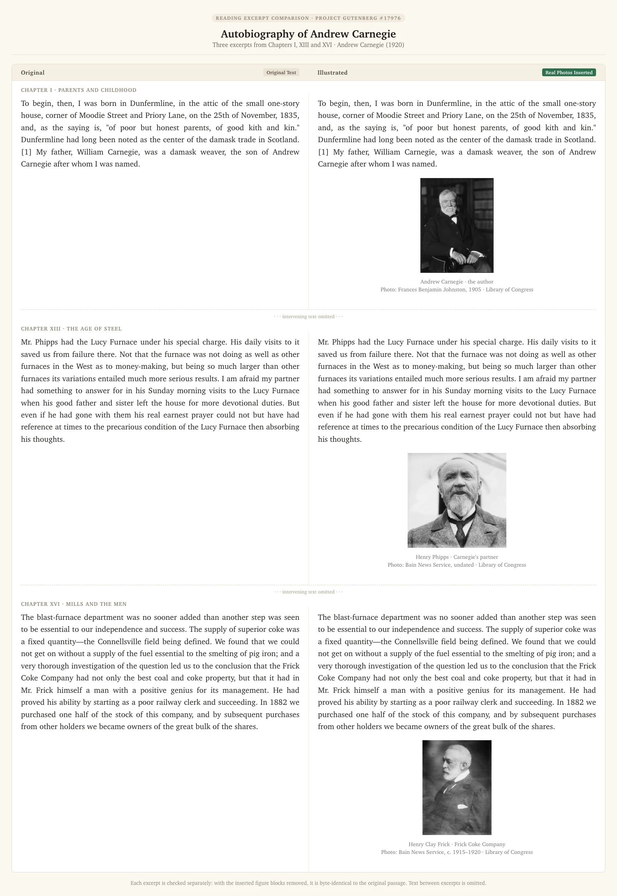

<h1 align="center">Book Illustrator</h1>

<p align="center"><b>一个 Agent Skill：给书配上真实图片——在人物、产品、地点、事件第一次出现的那一段后面插图，正文一字不改。</b></p>

<p align="center">
<a href="README.md">English</a> · 简体中文
</p>

<p align="center">
<a href="#效果">效果</a> ·
<a href="#在-agent-中使用">在 Agent 中使用</a> ·
<a href="#安装">安装</a> ·
<a href="#运行要求">运行要求</a> ·
<a href="#格式支持">格式支持</a> ·
<a href="#能力边界">能力边界</a> ·
<a href="#开发与测试">开发与测试</a>
</p>

## 效果

每张图把**同样几段摘录**并排展示：左边是原书，右边是本 Skill 实际生成的结果。每一行是一段摘录，文字完全相同，唯一的变化是在段落之后插入了带图注的照片；所选段落之间的原文已省略。

<p align="center">

<br><sub>梁启超《李鸿章传》第八章摘录。照片：李鸿章、伊藤博文、陆奥宗光。</sub>
</p>

<p align="center">

<br><sub><i>Autobiography of Andrew Carnegie</i>（《卡内基自传》），Project Gutenberg #17976。照片：安德鲁·卡内基、亨利·菲普斯、亨利·克莱·弗里克，美国国会图书馆藏。</sub>
</p>

[素材出处、署名与复现方法](examples/README.md)。

## 它能做什么

读传记、商业史、游记或博物类书籍时，书里会冒出几十个你从没见过的人物、产品、公司和地点。Book Illustrator 让你的编程 Agent 通读全书、列出这些对象，搜集真实照片、旧网页存档和产品截图，然后生成插图版：

- **正文插图**：在对象第一次出现的那一段后面插入一张带图注的小图（"名字 · 身份"，第二行可写年份或"今貌"等说明）。
- **章末图集**：每章末尾加一页，集中展示本章出现的对象。

两种形式可以都要，也可以只要一种。Agent 会先问两个偏好问题（插图放在哪里、配图范围多大），再给你看候选图预览供挑选，并先做一章样章，确认后再做全书。

## 在 Agent 中使用

1. **安装**：用下方[安装](#安装)里的一条命令装好 Skill。
2. **重启 Agent**（或新开一个会话），让它加载新装的 Skill。
3. **把书交给它**：直接附上文件，或粘贴书的绝对路径，例如 `/Users/me/Books/李鸿章传.epub`。
4. **粘贴一段提示词**：写明使用 book-illustrator、处理哪几章、主要配哪些人物、插在正文里还是做章末图集、先做样章、不要改动原文件。
5. **看样章**：Agent 会给出候选图预览（contact sheet）供你挑选，确认后再让它继续。

完整的首次提示词示例：

> 用 book-illustrator skill 处理 /Users/me/Books/李鸿章传.epub。先做第八章。给主要人物配真实的历史照片：李鸿章、伊藤博文、陆奥宗光。每个人第一次出现的那一段后面插一张带图注的照片，不要章末图集。先做这一章给我看效果，不要改动我的原文件。

看完样章后的追问示例：

> 图太多了：只保留后文还会反复出现的人物，每章最多五张。

> 效果可以。按同样方式做完全书，另外再导出一份 DOCX。

你会得到（放在单独的工作目录里，Agent 会告诉你路径）：

- 一份插图版：EPUB、HTML、Markdown 输出与原书相同的格式；TXT、DOCX、MOBI、AZW3、PDF 默认输出插图版 EPUB，需要时可另外导出其他[支持的格式](#格式支持)；
- 原文件，未作任何改动；
- 书末的图片来源一节，以及 `配图清单.md`：逐张列出图片的出处、许可和插入位置；
- 一份简短报告：插了多少张图，哪些人物没找到可靠的照片。

## 安装

使用 [Skills CLI](https://github.com/vercel-labs/skills) 一条命令安装：

```bash
npx skills add wavever/book-illustrator-skill
```

按提示选择你的 Agent。默认安装到当前项目；如果希望所有项目可用，加上 `-g`：

```bash
npx skills add wavever/book-illustrator-skill -g
```

也可以直接指定 Claude Code，跳过交互：

```bash
npx skills add wavever/book-illustrator-skill --skill book-illustrator -a claude-code -g -y
```

安装器会自动识别 [`skills/book-illustrator/`](skills/book-illustrator/) 中的 Skill，把说明、脚本和依赖清单一起安装。这个安装器需要 Node.js/npm；运行 Skill 时需要 Python，无需另外发布 npm 包。

从本地仓库安装可运行 `npx skills add . --skill book-illustrator`，用 `npx skills add . --list` 预览可安装的 Skill。

<details>
<summary>手动安装（可选）</summary>

请复制**整个** `skills/book-illustrator/` 文件夹（`SKILL.md`、`requirements.txt`、`scripts/`）。在仓库根目录运行：

```bash
# Claude Code，所有项目可用
mkdir -p ~/.claude/skills && cp -R skills/book-illustrator ~/.claude/skills/

# Claude Code，仅某个项目
mkdir -p /path/to/project/.claude/skills && cp -R skills/book-illustrator /path/to/project/.claude/skills/
```

Windows（PowerShell）：

```powershell
New-Item -ItemType Directory -Force $HOME\.claude\skills | Out-Null
Copy-Item -Recurse skills\book-illustrator $HOME\.claude\skills\
```

- **其他支持 Agent Skills 的工具**：把同一个文件夹复制到该工具文档说明的 skills 目录。
- **任何其他 Agent**：文件夹放在任意位置，然后告诉 Agent：*"阅读 /path/to/book-illustrator/SKILL.md 并按其说明给 ~/Books/my-book.epub 配插图。"*

</details>

### Python 依赖

`npx` 命令负责安装 Skill 文件。首次使用时，Agent 会检查 Python 依赖；缺少 Pillow、lxml 或 certifi 时，在这本书的工作目录里创建虚拟环境，通常无需手动运行 pip。如果想提前装好，请把 `SKILL_DIR` 换成安装器显示的 Skill 路径：

```bash
SKILL_DIR="/absolute/path/to/installed/book-illustrator"
python3 -m venv ~/.venvs/book-illustrator
~/.venvs/book-illustrator/bin/python -m pip install -r "$SKILL_DIR/requirements.txt"
```

在仓库根目录下，依赖清单是 `skills/book-illustrator/requirements.txt`；在已安装的 Skill 文件夹内则是 `requirements.txt`。然后告诉 Agent 用哪个 Python（例如"使用 ~/.venvs/book-illustrator/bin/python"）。

## 运行要求

| 组件 | 用途 | 是否必需 |
|---|---|---|
| 受维护的 Python（推荐 3.12+），以及 Pillow、lxml、certifi；兼容下限为 3.9 | 全部功能 | 必需 |
| 网络 | 找图（Wikidata、Wikimedia Commons、Openverse） | 必需，除非全部用你自己提供的图 |
| [Calibre](https://calibre-ebook.com/download) `ebook-convert` | 导入 DOCX/TXT/MOBI/AZW3/PDF；导出为这些格式 | 仅这些格式需要 |
| Java 11+ | `epubcheck_diff.py`（报告新增的 EPUB 校验问题） | 可选 |
| Google Chrome 或 Chromium | `preview.py` 渲染预览页；手动开启的旧版百度百科来源 | 可选 |
| `markdown-it-py` | 用 `preview.py` 渲染 Markdown 书籍 | 可选 |
| Node.js | `npx skills` 安装器；手动开启的旧版 ego-browser 模式 | 可选 |

默认找图不需要浏览器、登录或 API Key。如果你的 Agent 自带网页搜索，它可以把找到的图片地址交给本 Skill，与其他来源一样下载并校验。

## 格式支持

| 输入 | 处理方式 | 保证 |
|---|---|---|
| **EPUB 2/3、HTML/XHTML、Markdown**（原生） | 原文件只读。在保留原有标记的工作副本中，把插图放在原有元素*之间*，用 `<!--illus:start-->…<!--illus:end-->` 包起来 | `verify.py` 去掉这些块后，逐字节比对原书每个文件，**完全一致**。输出与输入同格式。 |
| **DOCX、TXT、MOBI、AZW3、有文字层的 PDF**（规范化） | Calibre 把副本转换为 `normalized.epub`，作为后续基准 | 原文件不会被修改；插图版 EPUB 与 `normalized.epub` 逐字节比对，**而不是**与原文件比对。转换会重排版式。 |
| **导出为 DOCX、MOBI、AZW3、PDF** | 已校验的 EPUB 再由 Calibre 转换 | 版式取决于 Calibre，需要人工查看；没有逐字节保证。 |

原生 HTML 与 Markdown 输出会附带一个 `<文件名>_assets/` 图片目录。

## 图片压缩

插入的图片会自动压缩为标准基线 JPEG（按 EXIF 自动转正、透明背景填充为白色、剔除冗余元数据；符合条件的 JPEG 会保留原图像数据，避免重复压缩）。默认使用 `balanced` 预设。

| 预设 | 最大边长 | 单图目标体积 | 适用场景 |
|---|---|---|---|
| `compact` | 800 px | 80 KiB | 优先省空间，适合手机或电纸书阅读 |
| `balanced`（默认） | 1024 px | 120 KiB | 兼顾画质与体积 |
| `high` | 1600 px | 300 KiB | 画质优先，文件可能比默认或旧版更大 |

直接告诉 Agent：*“按省空间模式重新导出，不重新找图。”* 也可以在 `entities.json` 现有的 `settings` 中加入：

```json
{"image_compression": "compact"}
```

或使用自定义覆盖：

```json
{"image_compression": {"preset": "balanced", "target_kb": 150, "max_side": 1200}}
```

- **单图尽力而为**：目标体积是单张图片的预算目标，受质量与尺寸下限保护，不做全书总容量的硬性封顶承诺；下载的候选原图完整保留在 `candidates/` 目录。
- **转换格式说明**：对于经 Calibre 转出的格式（DOCX、AZW3、MOBI、PDF），`compression-report.json` 记录的是原生中间体 EPUB 的大小，Calibre 最终导出的文件体积可能会有所不同。
导出后，`配图清单.md` 显示压缩前后的图片大小，`compression-report.json` 记录逐图尺寸、质量和是否达到目标。

## 工作流程

1. `prepare.py` 解包（或转换）书籍，为每个段落建立索引。
2. Agent 逐章阅读，把要配图的对象写入 `entities.json`。
3. `find_images.py` 搜集候选图：你的本地文件 → Agent 自己搜索得到的可选 `image_manifest.json` → Wikidata → Wikimedia Commons → Openverse。每次下载都限制大小、用 Pillow 完整解码并去重，来源信息写入 `SOURCE.json`。重复运行时，已成功的来源会跳过，失败的来源会重试。
4. `sheet.py` 把所有候选图拼成预览图；由你或 Agent 挑选、裁剪并写图注。
5. `export.py` 插入正文插图和章末图集，运行 `verify.py`，需要时再转换格式。
6. 书内默认附加图片来源页：保留记录到的作者、许可、来源页和缩放、裁剪等修改说明。工作目录里的 `配图清单.md` 还有插入位置、完整出处和缺图清单。

给 Agent 的完整说明见 [`SKILL.md`](skills/book-illustrator/SKILL.md)。

## 能力边界

- **只用真实图片**：照片、扫描件、截图、网页存档都可以，不使用 AI 生成的图片。
- **人物经核实才署名**：至少两个独立来源显示同一张脸才标注姓名。检索结果本身不算核实；名字有歧义时会标记出来请你确认，而不是猜。
- **分享插图版前**，核对书籍与图片的使用许可。
- **不支持 DRM**：受保护的书会被拒绝，不做任何解密。
- **PDF 需要文字层**：纯图片扫描版需要 OCR，本工具不支持。
- **TXT 编码**：自动识别 UTF-8 和 Unicode BOM；GBK、GB18030、Big5 等请传入 `--encoding`。
- **保留的是文字与标记，不是视觉版式**：原生格式中插图块以外的每个原始字节都保持不变，但新增的插图仍会改变分页与排版流；转换格式与导出格式还会经过 Calibre 重排。
- **各来源可用性因地区而异**：Wikidata、Commons、Openverse 可能较慢、限流或无法访问；失败会被记录，下次运行时重试。
- **默认面向中文书**：章末图集标题（`本章人物与产品`）和章节匹配规则默认按中文书设置；其他语言的书由 Agent 设置 `gallery_title` 与 `chapter_re`。

## 开发与测试

```bash
python3 -m venv .venv
.venv/bin/python -m pip install -r skills/book-illustrator/requirements.txt
.venv/bin/python -m unittest discover -s tests -t . -v
```

测试使用合成书籍、模拟网络和替身 Chrome，可以离线运行。没有安装 Calibre、Java/epubcheck 时，相关检查会自动跳过。参见 [CONTRIBUTING.md](CONTRIBUTING.md)。

```
skills/book-illustrator/
├── SKILL.md            # Agent 遵循的说明
├── requirements.txt
└── scripts/            # prepare、find_images、sheet、inject、export、verify 等
tests/                  # 离线单元测试与集成测试
docs/assets/            # README 演示图（权利另计，见 examples/README.md）
examples/               # 演示来源、署名与复现说明
```

## 许可

代码：[MIT](LICENSE) · [演示素材许可](docs/assets/LICENSE.md) · [隐私与数据流](PRIVACY.md)

<sub>使用 Openverse API；Openverse 未对本项目背书或认证。[来源条款](https://github.com/WordPress/openverse/blob/main/documentation/terms_of_service.md)。</sub>
